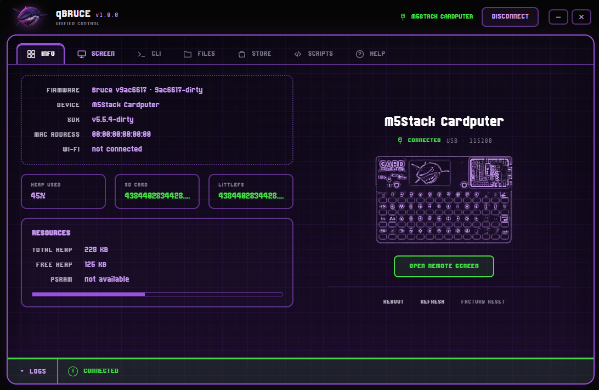
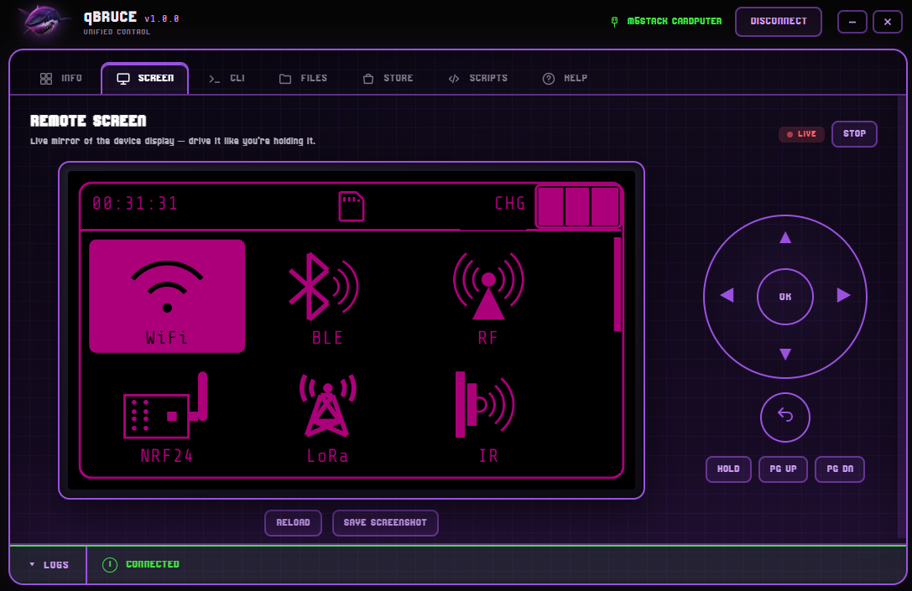
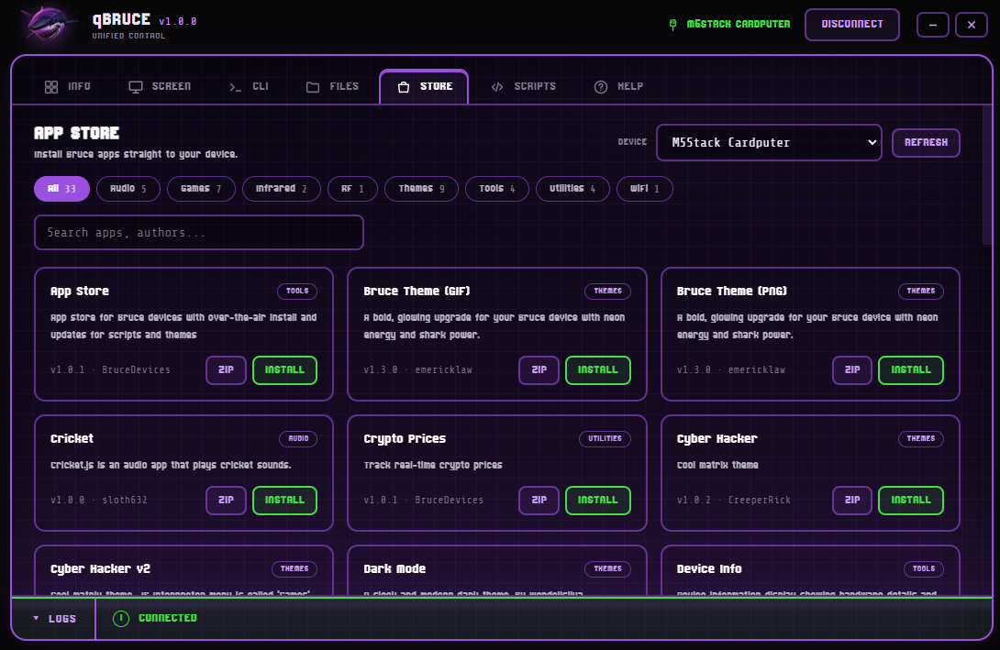
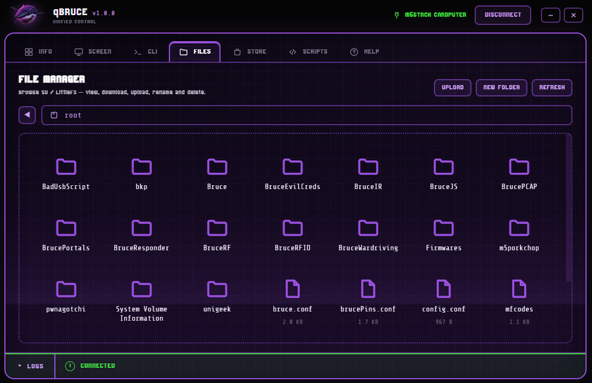

<div align="center">


# qBruce v1.0.2

**A desktop control panel for [Bruce](https://bruce.computer) devices, in the spirit of qFlipper.**

Connect your Bruce device over USB and manage everything from one clean, retro interface.

</div>

<p align="center">
  
</p>

---

## What is it?

qBruce is a single app that brings your Bruce device's tools together in one place, with no reconnecting and no juggling windows. Plug in over USB, hit **Connect**, and you get the device info, a live mirror of its screen, a file manager and the app store, all in one window.

It talks to the device over a single USB serial connection, so everything just works side by side.

---

## Features

- **Info**: firmware, hardware, Wi-Fi and storage of the connected device at a glance, with the matching device illustration.
- **Remote Screen**: a live mirror of the device display you can drive with an on-screen D-pad or your keyboard.
- **Terminal**: the full device command line, with history and colored output.
- **File Manager**: browse, view, download, rename, delete and upload files on the device, and run `.js` scripts straight from the list.
- **App Store**: browse the official Bruce app store, auto-filtered for your connected device, and install apps (or download the `.zip`) in one click.
- **Update check**: on launch qBruce checks GitHub for a newer release and offers the download.

---

## Screenshots

| Remote Screen | App Store | File Manager |
|:---:|:---:|:---:|
|  |  |  |

---

## Getting started

**Quick setup:** run `setup.bat` on Windows or `./setup.sh` on Linux / macOS.
It installs the dependencies and launches the app for you.

### Desktop app (recommended)

```bash
npm install     # first time only
npm start       # launch qBruce
```

Build a Windows portable `.exe`:

```bash
npm run dist:portable
```

### Build for Linux

You need Node.js 18+ and npm installed.

```bash
npm install          # first time only
npm run dist:linux   # build the Linux packages
```

This produces an **AppImage** and a **.deb** in the `dist/` folder.

- **AppImage** runs on most distributions with no install. Make it executable and launch it:
  ```bash
  chmod +x dist/qBruce-*.AppImage
  ./dist/qBruce-*.AppImage
  ```
- **.deb** installs on Debian, Ubuntu and derivatives:
  ```bash
  sudo apt install ./dist/qBruce_*.deb
  ```

To run it from source without building, use `npm start`.

**Serial access on Linux:** your user must be allowed to use the USB serial port.
Add yourself to the `dialout` group once, then log out and back in:

```bash
sudo usermod -aG dialout $USER
```

---

## Requirements

- A **Bruce** device connected over **USB**.
- **Windows** or **Linux** with the qBruce desktop app.
- Close any other serial monitor (Arduino IDE, PlatformIO, and similar) before connecting.

---

## Credits

- **[Bruce](https://bruce.computer)**: the firmware this app is built for.
- **[qFlipper](https://github.com/flipperdevices/qFlipper)**: visual inspiration.

---

<div align="center">
<sub>Made for the Bruce community. Use only on devices you own or are permitted to test.</sub>
</div>
